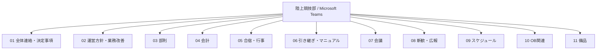

# 情報共有基盤の設計（Microsoft Teams）

## 1. 目的と背景

大学陸上競技部の運営において、連絡事項、意思決定、会計、行事、引継ぎなどの情報を目的別に整理し、必要な情報へアクセスしやすい環境を整えるため、Microsoft Teamsのチャンネル構成を設計した。

本資料では、実際に設定したチャンネル一覧をもとに、構成と設計意図を説明する。**運用効果の測定や定着状況については、今後の検証課題**である。

## 2. チャンネル構成

| チャンネル | 想定する情報・業務 | 分離した狙い |
|---|---|---|
| 01 全体連絡・決定事項 | 全体向けの連絡、決定内容 | 重要事項の参照先を明確にする |
| 02 運営方針・業務改善 | 運営方針の検討、改善案 | 日常連絡と中長期的な検討を分ける |
| 03 部別 | 部門ごとの情報 | 部門固有の話題を整理する |
| 04 会計 | 予算、支出、会計に関する連絡 | 金銭関連の情報をまとめる |
| 05 合宿・行事 | 合宿やイベントの準備 | 行事単位の調整を探しやすくする |
| 06 引き継ぎ・マニュアル | 手順書、担当業務の説明 | 代替わり時の知識継承を支える |
| 07 会議 | 議題、議事録、会議関連 | 議論の経緯を追いやすくする |
| 08 新歓・広報 | 新入生対応、広報活動 | 対外的な活動の情報を整理する |
| 09 スケジュール | 日程、予定の調整 | 日程情報の確認先を統一する |
| 10 OB関連 | 卒業生に関する連絡・調整 | 現役部員向け業務と区別する |
| 11 備品 | 備品の管理・調整 | 物品に関する情報を集約する |

※「想定する情報・業務」「分離した狙い」は、チャンネル名から整理した**設計意図**であり、全項目について運用実績が確認されたことを意味しない。

## 3. 設計上の工夫

### 業務別の情報整理
連絡事項を一か所に集めるのではなく、業務の種類に応じてチャンネルを分けた。これにより、投稿先と確認先を対応させることを目指した。

### 意思決定と検討過程の分離
「01 全体連絡・決定事項」と「02 運営方針・業務改善」を分け、確定した連絡事項と検討中の改善案を混同しにくい構成にした。

### 引継ぎを独立した業務として扱う
「06 引き継ぎ・マニュアル」を独立させ、担当者の交代時に必要な情報を探しやすくすることを意図した。

### 運営領域を幅広くカバー
会計、合宿・行事、新歓・広報、OB関連、備品など、日々の練習以外の運営業務も整理対象に含めた。

## 4. 現時点で示せる成果と未検証事項

**実施済みとして示せること**
- Microsoft Teams上に、業務目的に対応した11のチャンネルを設定したこと
- 重要連絡、運営方針、引継ぎなどの用途を分けた構成を用意したこと

**今後確認・改善すること**
- チャンネルごとの投稿ルールが利用者に理解されているか
- 必要な資料を探す時間が短縮されたか
- 幹部交代時に引継ぎが円滑に行えるか
- チャンネルの分け方が細かすぎないか、運用状況に応じた見直しが必要か

## 5. 今後追加予定の資料

- SharePointを用いた文書管理の構成と権限設計（実際の設定を確認した後に追記）
- 投稿・メンション・議事録の運用ルール
- 運用前後の比較と改善履歴

---

**公開にあたっての配慮：** 部員名、学籍番号、内部の会計金額、投稿本文、権限情報などは掲載していない。チャンネル名のみをもとに構成を再現している。
